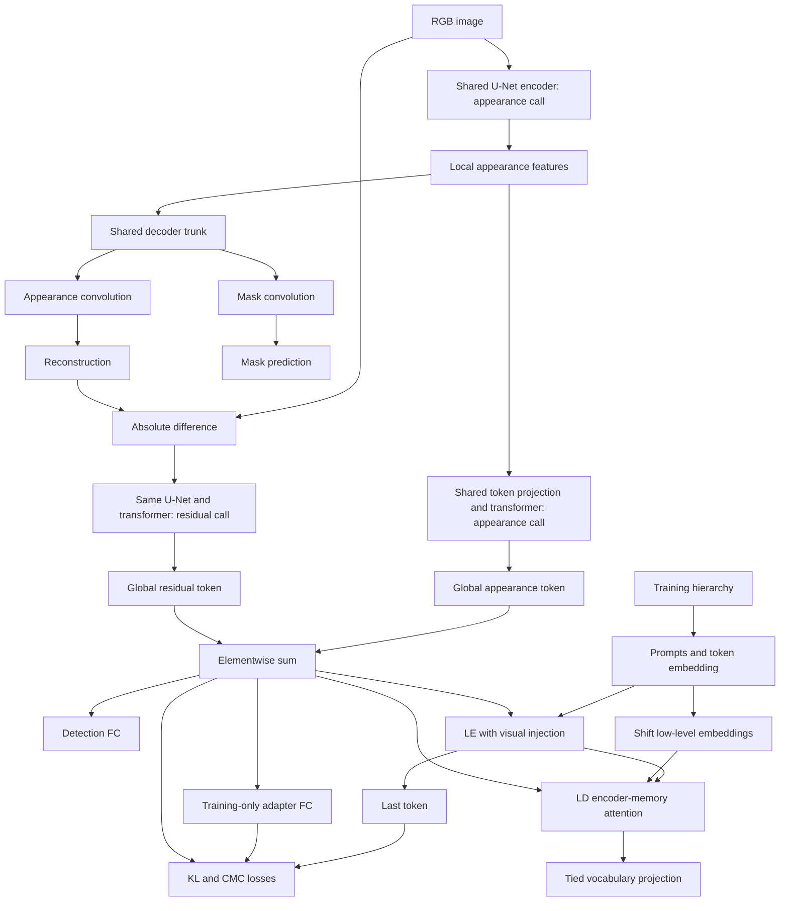

# MFVLR architecture and forward-pass contract

Research-only design. The component graph below follows [the supplied paper](../papers/MFVLR.pdf); proposed software interfaces are **ASSUMED engineering organization**, not code or claims about the authors' implementation. See [paper_analysis.md](paper_analysis.md) for the complete equation and evidence ledger and [assumptions.md](assumptions.md) for unresolved choices.

## Conventions

**EXPLICIT — p. 8 §IV-A:** batch size `b=8`, image-transformer depth `B=4`, LE depth `E=12`, LD depth `D=7`, width `d=512`, vocabulary `s=49408`, token count `n=308`, classes `f=2`, local feature dimensions `c=1024, h=w=14`. Uppercase `B` means depth, never batch size. Image resolution is 224×224, RGB (p. 5 §III-B).

**DERIVED:** the paper omits the batch dimension in most tensors. This document prepends `b`, retains `[b,1,d]` for global tokens, and uses channel-first image notation. Storage layout, integer index tensors and masks are **ASSUMED** PyTorch interface conventions. `r` denotes attention heads; the paper does not give its value. `dh=d/r` requires integer divisibility.

## Tensor inventory

| Symbol / tensor | Batched shape | Provenance and status |
|---|---|---|
| `I` input image | `[b,3,224,224]` | EXPLICIT p. 5 §III-B; batched DERIVED |
| `Isource` paired source image | `[b,3,H,W]` before agreed preprocessing | EXPLICIT need for pairs pp. 7–8; source dimensions unspecified; target construction, not a learned input |
| `y` image label | `[b,2]` one-hot in paper | EXPLICIT pp. 4/8; Fig. 4 gives 0 real, 1 fake; `[b]` integer representation ASSUMED |
| `M` target mask | `[b,224,224]` | EXPLICIT pp. 4/8; binary values; integer storage ASSUMED |
| `Iloc` appearance features | `[b,1024,14,14]` | EXPLICIT pp. 5/8 |
| Encoder skip features, if used | List of `[b,c_k,h_k,w_k]` | ASSUMED A02; no skip tensor shapes are specified |
| `Flat(Iloc)` | `[b,196,1024]` | DERIVED from spatial flattening p. 5 |
| `Proj(Flat(Iloc))` | `[b,196,512]` | DERIVED from channel projection p. 5 |
| Class token parameter | `[1,1,512]` broadcast over b | EXPLICIT learned class token; parameter storage ASSUMED A04 |
| `Itok`, `Itra_j`, `ITE` | `[b,197,512]` | DERIVED from Eq. (1), p. 5 |
| `Pi` | `[197,512]` plus broadcast batch axis | EXPLICIT formula `(hw+1)×d`, instantiated DERIVED |
| `Ig`, `Ir_g`, `Iv` | `[b,1,512]` | EXPLICIT pp. 5–6; `Iv=Ig+Ir_g` |
| Shared decoder features | `[b,c_dec,224,224]` if output-resolution trunk is chosen | ASSUMED A02/A05; `c_dec` and exact trunk output resolution absent |
| `Ipre`, `Ir` | `[b,3,224,224]` | EXPLICIT p. 5 |
| `Mpre` mask prediction | `[b,2,224,224]` | EXPLICIT pp. 6/8; logits/probabilities unresolved A18 |
| `ypre` detection logits | `[b,2]` | EXPLICIT p. 8; singleton token axis squeezed by interface |
| Token IDs `Ttok_e` | `[b,308]` | EXPLICIT pp. 6/8; integer IDs DERIVED from embedding lookup |
| `Wvoc` | `[49408,512]` | EXPLICIT pp. 6/8; 25,296,896 weights DERIVED |
| `Tlow_e`, `Ttra_j`, `Ttok_j`, `Tadd_j`, `Thig_e` | `[b,308,512]` | EXPLICIT dimensions pp. 6–7 |
| `Pe`, `Pd` | `[308,512]` | EXPLICIT pp. 6–7; trainability/initialization A04/A22 |
| `Tl`, `Tlpre` | `[b,1,512]` | EXPLICIT pp. 6/8 |
| VIM `Wque,Wkey,Wval,Wfc` per block | each `[512,512]` | EXPLICIT p. 7 Eqs. (4)–(11); biases absent from equations |
| VIM `q`, `k`, `v` | `[b,308,512]`, `[b,1,512]`, `[b,1,512]` | DERIVED Eqs. (4)–(6) |
| VIM `Q`, `K`, `V` after head split | `[b,r,308,dh]`, `[b,r,1,dh]`, `[b,r,1,dh]` | DERIVED Eqs. (7)–(9); axis layout ASSUMED |
| VIM logits/weights | `[b,r,308,1]` | DERIVED Eq. (10) |
| VIM concatenated output / delta | `[b,308,512]` | EXPLICIT Eq. (11), output projection in prose |
| LD shifted input `Ttra_t1` and each LD state | `[b,308,512]` | EXPLICIT p. 7 |
| LD masked self-attention map | `[b,r_d,308,308]` | DERIVED Eq. (13), head count unspecified |
| LD encoder-memory attention map | `[b,r_d,308,308]` | DERIVED Eq. (14), memory/query convention A11 |
| `Trec_d` | `[b,308,512]` | EXPLICIT Eq. (12) |
| `Tpre` vocabulary logits | `[b,308,49408]` | EXPLICIT Eq. (24); batched DERIVED |
| `Tgt` | `[b,308,49408]` conceptual one-hot | EXPLICIT Eq. (25); integer targets `[b,308]` ASSUMED equivalent storage |
| CMC raw similarity matrix | `[b,b]` = `[8,8]` | DERIVED Eqs. (20)–(21) |
| `Sv2l`, `Sl2v`, pair labels | each `[b,b]` | DERIVED; pair labels identity matrix EXPLICIT p. 8 |
| Six reduced losses and total | scalars | DERIVED need for optimization; reductions A17/A18 |

No explicit shape exists for hidden FF widths, intermediate convolutions, skip maps, decoder head kernels, or alternate patch-token VIM inputs. Those remain A02/A03/A05/A29.

## Module ownership and sharing

The following names are proposed interfaces (**ASSUMED**). Their responsibilities are paper requirements (**EXPLICIT** unless noted).

| Proposed module | Owned operations / parameters | Sharing / source |
|---|---|---|
| `MFVLR` | Orchestrates visual path and optional training-only text path | §III-A p. 4, Fig. 4 p. 5 |
| `SharedVisualEncoder` | U-Net encoder, spatial-to-token projection, learned class token, positions, four image transformer blocks | A single parameter set for appearance and residual roles; §III-B pp. 5–6 |
| `SharedVisionDecoder` | One U-Net decoder trunk | Shared AD/MD weights; §III-C p. 6 |
| `AppearanceHead` | Appearance reconstruction convolution | Three output channels; §§III-B/C |
| `MaskHead` | Localization convolution | Two output channels; §§III-C/IV-A |
| `ResidualGenerator` | Elementwise absolute difference | No learned parameters specified; §III-B p. 5 |
| `DetectionHead` | One fully connected map 512→2 | §III-E p. 8; no hidden MLP stack |
| `LanguageAdapter` | One fully connected map 512→512 | §III-E p. 8 |
| `PromptBuilder` / `TokenizerAdapter` | Label hierarchy → text → token IDs | §III-D p. 6; CLIP-referenced tokenizer; no pretrained embeddings |
| `VocabularyEmbedding` | Shared lookup/output matrix `Wvoc` | §III-D p. 6 and Eq. (24) p. 8 |
| `LanguageEncoder` | Encoder positions and 12 LE blocks, last-token extraction | §III-D p. 6 |
| `LanguageDecoder` | Shift operation, decoder positions, seven LD blocks, vocabulary projection | §III-D p. 7 and Eq. (24) |
| `VisionInjectionDelta` | Q/K/V projections, head attention, concatenation, output projection | Eqs. (4)–(11); residual-free API is ASSUMED A13 |
| `Objective` | Six separate terms and their sum | Eqs. (17)–(27); owns trainable CMC temperature or registers it with model |

**DERIVED — shared parameters:** IE and RE must not be two separately initialized networks. Optimizer parameters must be deduplicated. AD and MD share their decoder trunk; their final heads cannot be the same complete convolution because output channel counts differ (3 versus 2). No sharing across different transformer depths or between LE and LD is specified. Per-block VIM instances are strongly supported by notation and Table IX parameter increments (A27).

**ASSUMED A06:** when the decoder trunk is deterministic for a forward pass, execute it once and apply both heads. This is numerically equivalent to two identical evaluations without stochastic/stateful differences. If it uses dropout or batch normalization, execution count affects semantics and must be fixed and reported. Similarly, two sequential calls to a visual encoder with shared batch-normalization buffers are not equivalent in training to concatenating appearance/residual samples into one call.

## Training data construction

**EXPLICIT — pp. 4, 6–8, Fig. 6:** training consumes image `I`, authenticity `y`, hierarchy metadata and target mask `M`. Metadata supplies prompt levels: L1 authenticity, L2 forgery type, L3 GAN/diffusion family, L4 generator. Genuine prompts repeat `A photo of a real face` at all four levels. Fake examples are:

| Level | Paper example / template |
|---|---|
| L1 | `A photo of a fake face` |
| L2 EFS | `A photo of an entire synthesized face` |
| L2 FS | `A photo of an identity swapped face` |
| L2 AM | `A photo of an attribute manipulated face` |
| L3 | `A photo generated by the diffusion-based model` or `A photo generated by the GAN-based model` |
| L4 | `The source generative model of this photo is {generator}` |

Fig. 6 spells generator examples DDPM, LatentDiffusion, CollaborativeDiffusion, StyleGAN3, DiffFace, FSLSD, FaceSwapper, Diffae, and LatentTransformer. Whitespace, separators, truncation and literal strings for generators not pictured are unspecified (A08). Do not silently use table abbreviations such as LatDiff as if they were the exact L4 strings. The 308-token length does not establish four independently padded 77-token blocks; it is only compatible with that possibility.

**EXPLICIT — pp. 7–8:** for FS/AM targets, take the RGB absolute pixel difference between fake and corresponding source, convert to grayscale, divide by 255, threshold at 0.1. Real masks are all zero, EFS masks all one. The paired source is used to create `M`, not as the reconstruction target or an input required at inference. Grayscale coefficients, threshold boundary comparison, signed arithmetic, crop alignment and resize order are A01. Derived masks represent thresholded image changes, not necessarily semantic edited-region boundaries.

## Complete training forward pass

The order below is **DERIVED** by topologically sorting the explicit graph in §III-A (p. 4), §§III-B–D (pp. 5–7), Fig. 4 and the equations. It involves two calls to the shared visual encoder; it does not recursively reconstruct residual images.

1. **Prepare targets.** Obtain `y`, `M`, hierarchy-derived `T` and token IDs. Tokenization and mask construction are outside the learned forward graph. Augmentation order is unresolved A23.
2. **Appearance local encoding.** Run the U-Net encoder on `I` to get `Iloc`. Retain additional encoder skip tensors only under a declared U-Net choice (A02).
3. **Appearance global encoding.** Flatten `Iloc`, linearly project 1024→512, append a learned class token, add `Pi`, run B=4 blocks and extract `Ig` (Eqs. (1)–(2)). This can occur before or after step 4 because both depend on the same local features.
4. **Reconstruct and localize.** Decode appearance local features through the shared decoder trunk. Appearance head yields `Ipre`; mask head yields `Mpre`. Their only specified visual feature input is `Iloc` (§III-C). No residual-image decoder output is required.
5. **Generate residual.** Compute `Ir = abs(Ipre - I)` in a consistent input/reconstruction value range. Do not replace this with source-vs-fake mask differences.
6. **Residual global encoding.** Apply the SAME U-Net encoder and SAME token/transformer parameters to `Ir`, obtaining `Ir_g`. RE is the encoder role only; it does not request a new residual or decoder recursion.
7. **Fuse and classify.** Compute `Iv = Ig + Ir_g`. One FC head produces image logits `ypre`; a separate one FC adapter produces `Tlpre` for KL. CMC uses `Iv`, not `Tlpre` (Eqs. (19)–(23)).
8. **Embed prompts and run LE.** Look up IDs in `Wvoc`, add `Pe`, then apply E=12 blocks conditioned on `Iv`. Each block uses LN→self-MHA+residual, VIM injection+residual, FF+residual, in this order. Extract the last output token as `Tl`, retain all `Thig_e` as LD memory. Padding/EOS and extra norms are unresolved.
9. **Construct LD input.** Right-shift low-level prompt embeddings by inserting the begin-token embedding at the start and dropping the final original embedding, then add `Pd`. The word “appended” in the prose is ambiguous; insertion at the front is the causal next-token interpretation (A10). Do not shift `Thig_e` or reuse encoder positional sums as low-level embeddings.
10. **Reconstruct text.** Run D=7 blocks: masked self-attention + residual; cross-attention to `Thig_e` + residual; FF + residual; VIM conditioned on `Iv` + residual (Eqs. (12)–(16)). Multiply `Trec_d` by `Wvoc^T` to obtain vocabulary logits. Training is teacher-forced; no autoregressive sampling loop is needed to evaluate Eq. (25).
11. **Compute objectives.** FD uses `ypre,y`; AR uses `Ipre,I`; FL uses `Mpre,M`; KL compares `Tl` with `Tlpre`; CMC aligns batch `Iv,Tl`; LR compares tied-vocabulary predictions to original token IDs. Add the six terms with coefficients one, subject to the explicitly documented loss interpretations A17–A19.
12. **Optimize.** Apply Adam to all included trainable parameters and CMC temperature with the stated schedule. Freeze lists, separate pretraining, and stop-gradient edges are not specified; proposal A07/A19 is one joint graph.

This diagram shows dependencies, not a second undisclosed architecture. U-Net skip connections remain unresolved, so they are not invented in the graph.

## Inference forward pass

**EXPLICIT — p. 4 §III-A and Fig. 4 p. 5:** use steps 2–7 above but skip the adapter. Required input is only `I`. Outputs are the image prediction and mask prediction. AD and residual generation remain necessary for the detection branch; disabling AD at inference changes `Iv`.

**DERIVED:** neither target labels, source pairs, metadata, tokenization, LE, LD, nor `Tl` is needed. The mask can be produced immediately from appearance local features; the detection result waits for residual encoding. Reuse appearance features rather than recomputing them after residual creation.

**ASSUMED A24:** expose logits and probabilities separately; use two-class argmax for image/mask decisions and fake-class softmax probability for ROC-AUC. The paper does not prescribe this threshold/score convention. Evaluation mode and removal of the training-only branch must yield the same visual outputs from identical parameters and inputs.

## Gradient dependencies

The following are **DERIVED** for a fully differentiable joint implementation (A07/A19), not an explicit statement of the authors' detach policy.

| Loss | Direct trainable outputs | Paths into shared visual representation |
|---|---|---|
| AR | Appearance head + decoder | Appearance U-Net encoder; no direct TE/RE path |
| FL | Mask head + decoder | Appearance U-Net encoder; no direct visual-transformer/RE path |
| FD | Detection head | `Iv` → appearance TE and residual TE/U-Net → residual → AD → appearance encoder |
| KL | Adapter and LE/VIM/vocabulary | Direct adapter→`Iv`; language target also depends on `Iv` through VIM unless detached |
| CMC | LE/VIM/vocabulary and temperature | Direct `Iv` argument and image-conditioned `Tl`; residual path as above |
| LR | LD, LE memory, vocabulary, VIM | LE/LD conditioning on `Iv`; residual path as above |

Parameter sharing means a loss that does not traverse a particular role can still update weights that role uses later. For example FL updates the shared U-Net used by RE even though the FL computational graph does not run through the residual input. FD has no direct path through the mask head; it can update the shared decoder through AD. LR uses the tied vocabulary matrix as both input embedding and output projection.

At nonzero differences, the derivative of absolute residual with respect to `Ipre` is `sign(Ipre-I)` (**DERIVED**). Choice of subgradient at equality is framework behavior (**ASSUMED A07**). Under singleton key-axis softmax, Q/K task gradients are zero, so verification must not demand a nonzero gradient for every parameter.

## Resource and complexity checks

**DERIVED — paper dimensions:** input image-transformer length is 197, not a ViT patchification of the original RGB image. Language length is 308. At b=8, dense vocabulary logits contain 121741312 values, about 464.41 MiB in FP32 before gradients and other activations. A materialized floating one-hot LR target would incur comparable extra memory; integer targets preserve the categorical objective without that allocation. Tied vocabulary weights alone have 25.297M parameters.

**EXPLICIT — Tables IX/XV, pp. 14–15:** 141.00M parameters and 173.04G FLOPs for the complete class-token-VIM model. The paper does not identify profiler, multiply-add convention, batch size for profiling, or whether FLOPs include the language branch. These are diagnostic comparison values, not an exact executable architecture checksum. Report unique trained parameters and deployed visual parameters separately (A30).

**ASSUMED A31:** start mathematical verification in FP32. Mixed precision, fused kernels, gradient checkpointing, accumulation or token-chunked CE can be later engineering options only after value/gradient equivalence checks. Accumulating microbatch gradients does not by itself reproduce a contrastive batch of eight pairs.
