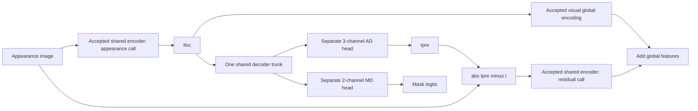

# Phase 2B Vision Decoder design contract

Date: 2026-10-11, client timezone Asia/Saigon. Revision 2: **D01–D08 APPROVED for Phase 2B VD implementation and verification, Option B `bottleneck_only` only**, by the explicit user implementation instruction. These remain engineering assumptions, not confirmed author architecture. Phase 2A is accepted: all 14 MVE test IDs / 15 cases, 32,078,912 unique parameters, M1–M5 and scoped N1. Option A remains PROPOSED as a future ablation and is neither approved nor implemented.

Scope: Appearance Decoder (AD), Mask Decoder (MD), their shared decoder trunk, the existing MVE boundary, and reconstruction-to-residual autograd. The accepted MVE, tests, configurations and Phase 2A artifacts are preserved. Loss implementations, classifier/FLT/VIM, datasets, training and evaluation remain outside authorization. [phase2b_test_plan.md](phase2b_test_plan.md) defines the approved checks; actual outcomes are recorded in [phase2b_implementation_report.md](phase2b_implementation_report.md).

The original design prose below is retained as proposal provenance. Its recommended Option B topology, heads, initialization, interface, integration and test/resource conventions are now **ASSUMED / APPROVED for Phase 2B only** under D01–D08. Any Option A detail remains ASSUMED / PROPOSED. Whole A01–A35 assumption IDs and later objectives/protocols are not blanket-approved. Both new decoder profiles independently record scoped D01–D08 approval; accepted MVE profiles and loader are unchanged.

## Evidence and traceability

Primary source: [MFVLR.pdf](../papers/MFVLR.pdf), PDF pp. 5–8, especially Fig. 4 and §III-C. Read the prose and figure together: neither establishes the adapted decoder's internal layers or encoder skip policy. The published unnumbered statements are preserved:

\[
I_{pre}=AD(I_{loc}),\qquad M_{pre}=MD(I_{loc})\quad\text{(p. 6, §III-C)},
\]
\[
I^r=|I_{pre}-I|\quad\text{(p. 5, §III-B)},\qquad
I_v=I_g^r+I_g\quad\text{(p. 6, §III-B)}.
\]

| Requirement | Evidence | Classification / missing detail |
|---|---|---|
| AD consists of a U-Net decoder and an appearance reconstruction convolution | p. 6 §III-C; Fig. 4 p. 5 | **EXPLICIT** family/components; hidden widths, upsampling, kernels, padding and activations missing |
| MD consists of a U-Net decoder and a localization convolution | p. 6 §III-C; Fig. 4 p. 5 | **EXPLICIT** family/components; hidden details missing |
| MD's U-Net decoder has the same network and weights as AD's | p. 6 §III-C; shared-weight symbol in Fig. 4 | **EXPLICIT** sharing; one versus two evaluations unspecified |
| Both decoder roles consume local appearance features | p. 6, `AD(Iloc)` / `MD(Iloc)`; Fig. 4 | **EXPLICIT** exposed input; intermediate encoder skips neither enumerated nor explicitly forbidden |
| Local tensor is 1024×14×14; image output is 3×224×224 | p. 5 §III-B; p. 8 §IV-A | **EXPLICIT** endpoints; leading batch axis **DERIVED** |
| Mask output is f×224×224, with f=2 | p. 6 §III-C; p. 8 §IV-A | **EXPLICIT** shape; raw logits, channel ordering and activation **ASSUMED** |
| Reconstruction participates in absolute residual and shared residual encoding | pp. 5–6 §III-B; Fig. 4 | **EXPLICIT** forward dependency; proposed no-detach integration extends accepted M3 gradient policy to VD |
| Appearance reconstruction and localization are supervised | Eq. (17), p. 7; Eq. (18), p. 8 | **EXPLICIT** expressions; spatial/class reductions and probability interpretation remain unresolved |
| No pretrained model initialization | p. 4 §II-B; accepted assumptions register A22 | **EXPLICIT** scratch-training statement; VD RNG/initializer choices **ASSUMED** |

Equation (17) is on PDF p. 7; Eq. (18) is on p. 8. Their reference expressions remain in [paper_analysis.md](paper_analysis.md). This contract does not insert a scalar reduction into (17) or make `log(raw_logits)` valid in (18). Proposed logits specify a module interface; executable paper objectives require later review.

Supporting evidence: MFVLR reference [44], [original U-Net, §2 PDF p. 4 and Fig. 1 p. 2](https://arxiv.org/pdf/1505.04597), describes an expanding path with up-convolution, encoder-feature concatenation and two ReLU convolutions, plus a 1×1 class head. Its original convolutions are unpadded and require cropping. This supports Option A as a family precedent; it does not establish MFVLR's adapted 224×224 decoder, sharing, reconstruction range or exact weights. No existing MFVLR implementation was consulted.

## Skip-policy ambiguity and recommended baseline

| Dimension | Option A: appearance encoder skips | Option B: bottleneck only |
|---|---|---|
| Dependency | Decode `Iloc` plus S3/S2/S1/S0 from the same appearance call | Decode only `Iloc` |
| MFVLR-specific evidence | Named U-Net family makes this plausible; prose does not disclose the additional tensors, and Fig. 4 does not draw stage-to-stage encoder skips | Directly follows the exposed `AD(Iloc)` / `MD(Iloc)` interface; omission of skips is not proof the authors omitted them |
| Cited U-Net fidelity | Closer to [44]'s concatenating expanding path, but padded layers remain adaptations | A U-Net-derived expanding path with skips removed; not the complete canonical [44] topology |
| Reconstruction behavior, expected rather than measured | Higher-resolution features may preserve edges/textures and ease optimization; direct feature bypass may encourage near-identity copying, weakening residual magnitude | Compression forces reconstruction through 1024×14×14 local features; may smooth textures or lose fine localization boundaries; reconstruction error may contain ordinary information loss |
| Residual meaning | Easier copying can suppress useful residuals; not guaranteed, since feature skips are not literal RGB copying | Bottleneck artifacts may dominate genuine/fake residuals; not guaranteed to improve detection |
| Gradient flow | Reconstruction/localization gradients reach bottleneck and skip features; shallow-stage gradients may bypass deeper encoder stages | Decoder-mediated gradients reach appearance encoder through `Iloc`; all reconstruction information uses the bottleneck path |
| Shared-weight gradient accumulation | Both heads and the residual branch still accumulate into one trunk and one visual encoder | Same sharing; absence of skips does not detach the reconstruction |
| Complexity | Shape/order/provenance checks for four skips; concatenations and wider first convolutions | Single input tensor; narrower first convolutions; simpler dependency audit |
| Unique VD parameters under the exact proposals below | 12,188,805 | 9,055,365 |
| Resource cost | More weights and concatenation storage; high-resolution features are consumed | Less decoder storage; accepted MVE still retains its four appearance skips |

**Recommendation: Option B (`bottleneck_only`) as the initial reference baseline.** It follows the explicitly exposed local-feature dependency without introducing an extra decoder input. This is a conservative engineering interpretation, not a recovered author detail or a claim of greater overall paper fidelity. Option A is equally unresolved at the MFVLR level and has stronger canonical U-Net support. If canonical U-Net structure is preferred over the written input boundary, select A explicitly instead.

This recommendation revises the earlier, unapproved skip-decoder proposal in [implementation_contract.md](implementation_contract.md), deferred VD paragraph, and the corresponding `proposal.vision_decoder` fields in `paper_reference.yaml`. Those existing files are not amended or promoted to approval in Phase 2B. In particular, the current reference config still describes Option A as a future proposal; it must not be treated as the Option B contract. After a selection is approved, proposed new `decoder_reference.yaml` / `decoder_debug.yaml` profiles and a dedicated strict decoder schema will record the selected policy and scoped VD approval. They will reference the accepted MVE profile without changing its loader, approval records or numerical tests. The new VD profile will be authoritative for decoder construction; the existing decoder blueprint remains historical and unapproved. There is no automatic fallback based on whether a caller supplies skips.

Option B leaves the accepted `AppearanceEncoding.skips` intact: the decoder ignores them, while the existing MVE validates all four when reusing an appearance record. Do not change `MVE.encode_appearance`, strip its skips, or relax its record validation to implement B. Under A, only appearance-call skips are eligible; residual-call features, raw image concatenation, teacher/source images and Transformer tokens are not decoder inputs.

## Exact proposed topology

Everything in this section is **ASSUMED / PROPOSED**, except the cited endpoints. Both options use four factor-two stages, one deterministic shared trunk, and independent output heads. Batch `b≥1`, NCHW float32, 224×224 fixed endpoints. Every upsampling is a biased `ConvTranspose2d`: kernel 2, stride 2, padding 0, output_padding 0, dilation 1, groups 1. There is no activation immediately after that up-convolution. Each following convolution is biased 3×3, stride 1, zero padding 1, dilation 1, groups 1, followed by ordinary non-inplace ReLU. No normalization, dropout, residual CNN blocks, bilinear interpolation, cropping, resizing or stochastic depth.

The transposed-convolution shape rule derives `Hout=(Hin−1)×2+(2−1)+1=2Hin`, likewise width. These proposed operator details are not extracted from the paper. Labels U1–U4 are in forward order, 14→28→56→112→224.

| Stage / operation | Input | Option B output | Option A output / extra input |
|---|---|---|---|
| Bottleneck | `Iloc` | [b,1024,14,14] | Same |
| U1 up: 1024→512 | Bottleneck | [b,512,28,28] | Same |
| U1 feature assembly | Up result | Unchanged [b,512,28,28] | Concatenate S3 [b,512,28,28] → [b,1024,28,28] |
| U1 Conv1 + ReLU | Assembled tensor | 512→512: [b,512,28,28] | 1024→512: [b,512,28,28] |
| U1 Conv2 + ReLU | Conv1 output | 512→512: [b,512,28,28] | Same |
| U2 up: 512→256 | U1 output | [b,256,56,56] | Same |
| U2 feature assembly | Up result | Unchanged [b,256,56,56] | Concatenate S2 [b,256,56,56] → [b,512,56,56] |
| U2 Conv1 + ReLU | Assembled tensor | 256→256: [b,256,56,56] | 512→256: [b,256,56,56] |
| U2 Conv2 + ReLU | Conv1 output | 256→256: [b,256,56,56] | Same |
| U3 up: 256→128 | U2 output | [b,128,112,112] | Same |
| U3 feature assembly | Up result | Unchanged [b,128,112,112] | Concatenate S1 [b,128,112,112] → [b,256,112,112] |
| U3 Conv1 + ReLU | Assembled tensor | 128→128: [b,128,112,112] | 256→128: [b,128,112,112] |
| U3 Conv2 + ReLU | Conv1 output | 128→128: [b,128,112,112] | Same |
| U4 up: 128→64 | U3 output | [b,64,224,224] | Same |
| U4 feature assembly | Up result | Unchanged [b,64,224,224] | Concatenate S0 [b,64,224,224] → [b,128,224,224] |
| U4 Conv1 + ReLU | Assembled tensor | 64→64: [b,64,224,224] | 128→64: [b,64,224,224] |
| U4 Conv2 + ReLU | Conv1 output | 64→64: [b,64,224,224] | Same; call this F |
| AD head | F | Biased 1×1 Conv 64→3 → [b,3,224,224] | Same |
| MD head | F | Biased 1×1 Conv 64→2 → [b,2,224,224] | Same |

Option A concatenation order is `[upsampled, appearance_skip]` along channels, with skips received in the existing `(S0,S1,S2,S3)` order and consumed in reverse. No crop is required because the accepted encoder is padded. Option B has no concatenation, placeholder zero-skip tensors or hidden skip adapter. Selecting A changes only these assembly operations and first-convolution input channels; sharing, heads and gradient conventions remain as proposed.

## AD output, MD logits and parameter ownership

**Proposed AD head:** identity activation; output in unrestricted real values, subject to finite-value validation. Appearance inputs follow the accepted caller RGB/[0,1] convention, but reconstruction may leave [0,1]. No sigmoid/tanh, clamp, image-identity addition, min-max scaling or `/255` occurs inside VD or before the residual. Consequently `Ir` is nonnegative but may exceed 1. This preserves the accepted MVE boundary, not a paper-specified reconstruction range (p. 6 §III-C; A05).

Sigmoid would bound outputs to (0,1) while introducing saturation; tanh would require an explicitly aligned image scale; clamping would give zero outside-range gradients and alter residuals. None is specified by MFVLR. Identity is recommended because it introduces no unreported output nonlinearity, but unbounded early reconstructions can enlarge residual activations. This risk must be logged rather than silently normalized away.

**Proposed MD head:** unrestricted two-class logits, identity activation. Channel convention: 0 unmodified/background, 1 manipulated/foreground; the numerical mask values are supported by §III-E pp. 7–8, but channel indexing is an engineering choice. No softmax, sigmoid, argmax or threshold in `VisionDecoder.forward`. Probability conversion, categorical supervision, reduction and metric policies remain deferred. A single-channel BCE head would change the stated `f=2` output. The 3-channel and 2-channel convolutions are distinct parameter objects, not slices of a combined five-channel head.

**Proposed ownership:** `VisionDecoder` registers exactly `trunk`, `appearance_head` and `mask_head`. Both conceptual AD/MD roles use the single trunk output F, computed once per appearance batch. No independently registered AD/MD trunk copies or separate normalization state. The trunk does not share weights with MVE's CNN: paper sharing is AD↔MD and IE↔RE, not encoder↔decoder. Checkpoint and optimizer enumeration contain each unique tensor once. With twelve trunk convolutions and two heads, there are 28 VD parameter tensors (weight/bias pairs), for either option.

## Initialization

**ASSUMED / PROPOSED (A22 decoder portion):** allocate and initialize only the VD on CPU with its own private generator, seed 0. Preserve the caller's RNG and accepted MVE parameters. Initialize unique modules once in order U1 up/Conv1/Conv2, U2, U3, U4, appearance head, mask head. No random draw for constant bias zeroing.

| Weights | Initializer |
|---|---|
| Each up-convolution | Xavier uniform gain 1 on stored `[Cin,Cout,2,2]` tensor; fan-in=`4×Cout`, fan-out=`4×Cin`; bound `sqrt(6/(4×(Cin+Cout)))` |
| Each 3×3 ReLU convolution | Kaiming normal, fan_in=`9×Cin`, nonlinearity ReLU; variance `2/(9×Cin)` |
| Each identity 1×1 output head | Xavier uniform gain 1; bound `sqrt(6/(64+Cout))` |
| Every bias | Exactly zero |

The explicit up-convolution initializer avoids ambiguous transpose-weight fan conventions. It is a new decoder proposal, not an extension of M5's approved encoder initialization. No global model-wide initialization pass may overwrite the MVE. No pretrained loading, zero-init identity reconstructor or decoder-only pretraining is implied. Cross-version bitwise initialization remains unguaranteed.

## Parameter accounting

**DERIVED from the above ASSUMED topology**, computed arithmetically during design review; not measured on an implemented decoder. For biased ConvTranspose 2×2: `4×Cin×Cout+Cout`. For biased Conv 3×3: `9×Cin×Cout+Cout`. For a 1×1 head: `64×Cout+Cout`.

| Owner | Option B up / Conv1 / Conv2 | Option B subtotal | Option A up / Conv1 / Conv2 | Option A subtotal |
|---|---|---:|---|---:|
| U1 | 2,097,664 / 2,359,808 / 2,359,808 | 6,817,280 | 2,097,664 / 4,719,104 / 2,359,808 | 9,176,576 |
| U2 | 524,544 / 590,080 / 590,080 | 1,704,704 | 524,544 / 1,179,904 / 590,080 | 2,294,528 |
| U3 | 131,200 / 147,584 / 147,584 | 426,368 | 131,200 / 295,040 / 147,584 | 573,824 |
| U4 | 32,832 / 36,928 / 36,928 | 106,688 | 32,832 / 73,792 / 36,928 | 143,552 |
| **Shared trunk** | | **9,055,040** | | **12,188,480** |
| AD head | 195 | 195 | 195 | 195 |
| MD head | 130 | 130 | 130 | 130 |
| **Unique VD** | | **9,055,365** | | **12,188,805** |
| **Accepted MVE + VD** | | **41,134,277** | | **44,267,717** |

Option A adds 3,133,440 unique parameters, all in the four first post-assembly convolutions. An AD-only view has trunk+195 parameters, an MD-only view trunk+130; their sum would double-count the trunk. Combined counts exclude classifier, language, adapters and trainable loss temperatures. Matching the paper's rounded full-model totals cannot choose a skip policy or establish architecture fidelity.

## Integration API proposal

All names, records and API rules here are **ASSUMED / PROPOSED (A35)**. A chosen skip policy is fixed at construction, explicitly provided by an approved decoder configuration; there is no tensor-dependent policy selection. Definitions describe interfaces, not implementation code.

| Interface | Contract |
|---|---|
| `VisionDecoder.forward(local, *, skips=None)` | `local` [b,1024,14,14]. B requires `skips=None` and rejects supplied skip tensors; A requires the ordered four appearance skips with exact accepted shapes. Computes trunk once, then both heads. |
| `VisionDecoder.decode_appearance(appearance)` | Requires the existing `AppearanceEncoding` type. For B passes only `appearance.local`; explicitly does not consume `appearance.skips`, tokens or global token. For A passes local and appearance skips. No MVE ownership or re-encoding. |
| `VisionDecoderOutput` | Immutable per-call container by convention: `features` F [b,64,224,224], `reconstruction` [b,3,224,224], `mask_logits` [b,2,224,224]; graph-connected tensors, no persistent cache. |

Boundary checks: tensor/type/rank/exact endpoint, b≥1, same batch/device/FP32 as VD parameters, finite values. A also validates all four skips and their order/spatial/channel shapes. No implicit casts, device moves, broadcasting, crops or interpolation. B's wrapper does not validate unused skip values as decoder inputs; MVE retains its own unchanged full-record validation. Provenance remains a caller obligation: all consumed features come from the same appearance input and current parameters/graph, never reused across optimizer steps.

One finite integration sequence is: `appearance = mve.encode_appearance(I)` → `decoded = vd.decode_appearance(appearance)` → `encoded = mve(I, decoded.reconstruction, appearance_encoding=appearance)`. Read mask logits from `decoded`, fused visual features from `encoded`. This avoids repeated appearance CNN/Transformer calls and computes VD exactly once. RE receives only `abs(Ipre−I)`; it never invokes VD. Both train/eval use the same graph; actual gradient recording remains controlled by the caller's autograd context. Phase 2B does not authorize a full-model image-only wrapper or detector head.

Diagram shows recommended B. A adds four appearance-feature connections to D; that is an explicitly assumed dependency expansion, not an amended published equation.

## Gradient contract

**Published forward graph + accepted M3 convention; new VD integration choices remain PROPOSED.** No decoder output, local tensor, skip, residual, shared parameter or per-call record is detached/frozen. `abs` is the existing MVE operation: sign derivative away from zero and framework zero subgradient at equality. No custom derivative is introduced.

For a differentiable synthetic probe S of residual-global features, away from zero residual:

\[
\frac{\partial S}{\partial\theta_{AD}}=
\frac{\partial S}{\partial I_g^r}
\frac{\partial I_g^r}{\partial I^r}
\operatorname{diag}(\operatorname{sign}(I_{pre}-I))
\frac{\partial I_{pre}}{\partial\theta_{AD}}.
\]

This is a **DERIVED chain-rule audit**, not a new published objective. The reconstruction head and shared decoder trunk must be graph-connected through RE. Residual-only probes do not reach the distinct mask head. A mask-logit probe reaches the mask head, shared trunk and appearance local encoder, but not the appearance head or Transformer-only parameters. Reconstruction also does not use appearance Transformer tokens; a residual-global probe does use the shared Transformer during RE.

With B, the decoder-mediated local-encoder gradient enters through `Iloc`; with A, additional entry points are the four skips. With a fused probe, the shared visual encoder can receive gradients from appearance-global encoding, residual encoding and reconstruction-mediated appearance encoding; autograd sums these contributions on the same objects. Not every ReLU parameter must have a nonzero gradient for every input. Test isolated paths and detached controls, not that overstrong condition. Detaching only `Ipre` removes the decoder-mediated path while leaving RE parameters and the direct `−I` residual-input path trainable.

Shared decoder gradients from AD-only and MD-only probes add; the head-only parameters remain separate. Potential AR/FL/residual-objective conflicts and collapse to easy reconstruction are training risks, not reasons to silently freeze a head or change the residual formula. No objective, optimizer schedule or training run is authorized here.

## CPU/GPU resource considerations

All quantities below are **DERIVED storage estimates**, not measured peak CPU RAM/VRAM or runtime. MiB=2^20 bytes; FP32=4 bytes. Batch 8 is the paper setting (§IV-A p. 8), not an approved resource guarantee.

| Parameter storage | B VD only | A VD only | B MVE+VD | A MVE+VD |
|---|---:|---:|---:|---:|
| Weights only, MiB | 34.54 | 46.50 | 156.91 | 168.87 |
| Weights + gradients, MiB | 69.09 | 92.99 | 313.83 | 337.74 |
| Weights + gradients + two FP32 Adam moments, MiB | 138.17 | 185.99 | 627.66 | 675.47 |

The Adam row is planning arithmetic only, excluding optimizer temporaries, state-step metadata and mixed-precision master copies; training remains deferred. These weights exclude all other full-model modules.

| One FP32 sample: decoder resolution | Single width-C feature, MiB | Additional A concat width-2C tensor, MiB |
|---|---:|---:|
| 512×28×28 | 1.53125 | 3.0625 |
| 256×56×56 | 3.0625 | 6.125 |
| 128×112×112 | 6.125 | 12.25 |
| 64×224×224 | 12.25 | 24.5 |
| Sum of these selected tensors | 22.96875 | 45.9375 |

Counting one upsample result and two activated convolution outputs per stage gives a selected B feature inventory of 68.90625 MiB per sample; A additionally has 45.9375 MiB of concatenations if retained. This is not a complete saved-tensor inventory or a peak estimate: ReLU inputs, convolution workspaces, gradients, liveness and allocator behavior differ. Both heads together add 0.95703125 MiB/sample; the bottleneck adds 0.765625 MiB/sample. Scale these tensor byte counts linearly by b for b=1/2/8, but do not extrapolate execution peaks from them.

Accepted MVE still retains appearance skips totaling 22.96875 MiB/sample under B, and both encoder-role computation graphs remain live for backward. Avoid claiming that B removes all encoder-skip storage. Attention/FFN saved tensors, pooling indices, both CNN graphs and autograd metadata add memory. Returning F in a per-call record extends its lifetime; discard records after each diagnostic rather than storing a list of graphs.

Proposed execution gate: CPU b=1 decoder forward first, CPU b=1 integrated forward/backward, then b=2 debug; GPU FP32 b=1/2 when available and b=8 only after measured capacity. Record process RSS/peak where supported and GPU allocated/reserved peaks after synchronization, plus device/runtime and inference-versus-autograd mode. No CUDA device was available in Phase 2A; no new GPU capacity was measured in this design review. Inference under no-grad has different memory from backward. OOM must be reported; no smaller channels, fewer stages, skipped heads, detach, AMP, checkpointing or CPU offload may be introduced as a hidden fix. Additional resource strategies require a disclosed separate decision.

## Phase 2B approval records

All D01–D08 are **ASSUMED / APPROVED for Option B Phase 2B only**, mapped to the existing assumption register; none blanket-approves the entire A-ID. Source: explicit user Phase 2B implementation instruction, client date 2026-10-11. This scoped record supersedes the original recommendation status for Option B only.

| ID | Assumption portions | Proposed decision | Status | Consequence / alternative |
|---|---|---|---|---|
| D01 | A02 skip policy | B bottleneck-only reference; A retained as an unapproved future ablation | APPROVED | B matches exposed input dependency; A remains unimplemented |
| D02 | A02 decoder topology | Four exact biased transpose-conv / double-3×3-ReLU stages above, Option B channels; no norms/dropout | APPROVED | Fixed 14→224 shapes/counts; bilinear upsampling or different kernels are separate choices |
| D03 | A06 decoder sharing | One registered trunk, one evaluation, separate 3/2-channel heads | APPROVED | Honors explicit sharing; no copied role trunks or encoder/decoder weight tying |
| D04 | A05 output heads; A18 interface only | Biased 1×1 heads, identity appearance output and raw two-class mask logits; channel 0/1 convention | APPROVED | Unbounded reconstruction/residual; does not approve CE/BCE/reductions or metrics |
| D05 | A22 decoder initialization | Private CPU seed-0 stream; Xavier up/head weights, Kaiming 3×3 weights, zero biases; prescribed order | APPROVED | Scratch initialization without touching accepted MVE; different schemes remain alternatives |
| D06 | A35 VD interface/config | Fixed-policy APIs and graph-connected per-call record above; strict input checks; separate VD profiles/schema referencing accepted MVE config | APPROVED | B rejects explicit skips in low-level API; wrapper consumes only approved inputs; no automatic policy switch or changes to accepted MVE loader/tests |
| D07 | A07 production VD integration | No detach/clamp/freeze; cached appearance reused; residual encoder does not decode | APPROVED | Reconstruction-mediated autograd preserved; losses/training remain deferred |
| D08 | A30/A31/A35 verification only | Counts for selected policy, staged tests/resource recording in companion plan; general tolerances unchanged | APPROVED | CPU acceptance first; GPU capacity separately recorded; N1 applies only to existing MVE-T12 |

Production Option B VD implementation and verification are authorized for **Phase 2B only**. Loss/training/evaluation and next-component decisions remain DEFERRED. Stop after VD implementation/verification and wait for review. Author architecture remains unconfirmed; Option A needs separate future approval.

Original design-review validation: source pages 5–6 were text-extracted and visually inspected; p. 8 dimensions and cited U-Net §2 were checked. Parameter/storage arithmetic was independently computed without instantiating a VD at that time. Accepted MVE/test/config hashes matched the Phase 2A N1 manifest. The tables above retain their design derivations; subsequent measured production counts and actual test executions are recorded separately in the Phase 2B implementation report.
